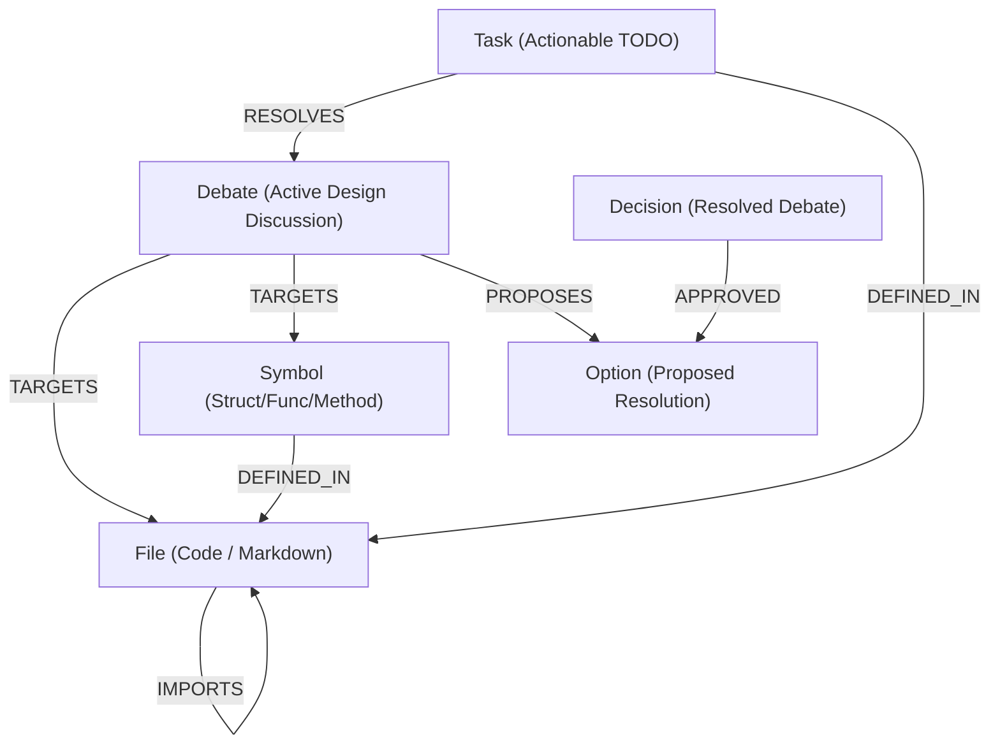

# 🚀 Scheduler

[](https://golang.org)
[](#)

**Scheduler** is a lightweight, local-first background engine written in Go. It builds and maintains a live **Knowledge Graph of your active workspace**, capturing not just AST-level code symbols and import relationships, but also the **intent, architectural debates, decisions, and tasks** that shape the project.

It acts as a semantic bridge between your codebase's structure and your engineering design history, allowing human developers and AI coding agents to maintain perfect context alignment.

---

## 🌌 Key Features

- **Multi-Format Ingestion**: Natively parses Go AST (extracting packages, functions, structs, interfaces, and methods) and Markdown documents (extracting design debates, options, decisions, and checklists).
- **Event-Driven Scheduling**: Combines an event-driven `fsnotify` file system watcher (reactive, real-time updates with built-in debouncing) and a background wall-clock ticker for periodic sweeps into a unified, race-free coalescing loop.
- **Pure-Go SQL Persistence**: Stores the graph in a zero-dependency, Cgo-free SQLite database (`.knowledge/graph.db`) using UUIDv7 surrogate keys (enabling monotonic, time-sliceable queries).
- **RESTful HTTP API**: Exposes JSON endpoints to query the complete graph, trigger manual syncs, and delete nodes with cascading edge cleanup.
- **Modular & Importable**: Structured as clean, reusable packages (`pkg/parser`, `pkg/engine`) that can be imported directly into other Go projects.

---

## 🧠 Knowledge Graph Schema

The database models workspace nodes and edges using the following structure:

### Graph Architecture



### Nodes

| Node Type | Description | Key Properties |
| :--- | :--- | :--- |
| **`File`** | A source code (e.g. `.go`) or documentation (e.g. `.md`) file. | `filepath`, `package` |
| **`Symbol`** | AST programming entities (structs, interfaces, functions, methods). | `name`, `subtype`, `package`, `receiver` |
| **`Debate`** | An active technical debate or design discussion. | `id`, `title`, `status` |
| **`Option`** | A proposed alternative or solution within a debate. | `id`, `description` |
| **`Decision`** | A resolved debate showing the approved option and rationale. | `id`, `title`, `status`, `rationale` |
| **`Task`** | A concrete TODO checklist item mapped to a file or debate. | `description`, `completed` |

### Edges (Relationships)

| Source Node | Edge Label | Target Node | Purpose |
| :--- | :--- | :--- | :--- |
| `File` | `IMPORTS` | `Module` | Tracks imported packages/module dependencies. |
| `Symbol` | `DEFINED_IN` | `File` | Locates the file where a struct, function, or type is defined. |
| `Debate` | `TARGETS` | `File` \| `Symbol` | Tracks components affected by a design debate. |
| `Debate` | `PROPOSES` | `Option` | Lists the solutions proposed to resolve the debate. |
| `Decision` | `APPROVED` | `Option` | Captures which option was approved. |
| `Task` | `RESOLVES` | `Debate` | Links outstanding tasks to the debates they clear. |
| `Task` | `DEFINED_IN` | `File` | Tracks where a checklist item or task is written down. |

---

## 📂 Project Layout

The repository follows a clean, standard Go layout:

```text
├── cmd/
│   └── scheduler/          # Entrypoint (main.go) bootstrapping the DB, server, and loops
├── pkg/
│   ├── api/                # RESTful HTTP + JSON API Server
│   ├── engine/             # Core scheduling engine, file walker, fsnotify watcher, and loop
│   └── parser/             # Go AST & YAML-frontmatter Markdown parsers
├── internal/
│   ├── storage/            # SQLite implementation and graph query migrations
│   ├── ignore/             # Ignored directories/files pattern matching (.gitignore)
│   └── testutil/           # Test helpers
├── decisions/              # Architecture Decision Records (ADRs) tracking design history
├── research/               # Technical research documents and schedule optimization concepts
├── Makefile                # Build automation scripts
└── GEMINI.md               # Context window bootstrap memory and live roadmap
```

---

## ⚡ Getting Started

### Prerequisites

- Go `1.25` or higher

### Build & Run

All common developer tasks are orchestrated via the `Makefile`:

```bash
# Compile the binary to bin/scheduler
make build

# Run the scheduler in development mode
make run

# Execute all package unit and integration tests
make test

# Run tests and generate code coverage reports
make test-cover

# Clean built binaries and test coverage profiles
make clean
```

---

## 📟 REST API Endpoints

When the scheduler is running (defaulting to port `8080`), you can interact with the graph using JSON REST API:

### 1. Retrieve the Graph
- **Endpoint**: `GET /api/graph`
- **Response**: The entire graph payload structured with `"Nodes"` and `"Edges"`.
- **CURL Example**:
  ```bash
  curl http://localhost:8080/api/graph
  ```

### 2. Trigger Ingestion Sweep
- **Endpoint**: `POST /api/ingest`
- **Response**: `{"status":"Ingestion triggered"}`
- **CURL Example**:
  ```bash
  curl -X POST http://localhost:8080/api/ingest
  ```

### 3. Delete Node (Cascade Cleanup)
- **Endpoint**: `DELETE /api/nodes?id=<node_id>`
- **Response**: `{"status":"node <node_id> successfully deleted"}`
- **CURL Example**:
  ```bash
  curl -X DELETE "http://localhost:8080/api/nodes?id=pkg.MyStruct"
  ```

---

## 🧠 Agent & Developer Orientation

- **Bootstrap Memory**: Newly woke agents or developers starting in this repository should always review [GEMINI.md](GEMINI.md) first to understand the active roadmap, design debates, and operational context.
- **Knowledge Schema Detail**: See [graph_schema.md](graph_schema.md) for database column and entity modeling.
- **ADRs**: Consult the [decisions index](decisions/index.md) to explore the technical debates that shaped this implementation.
